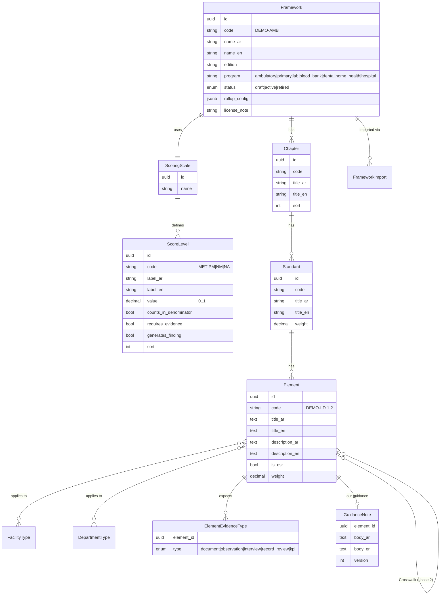
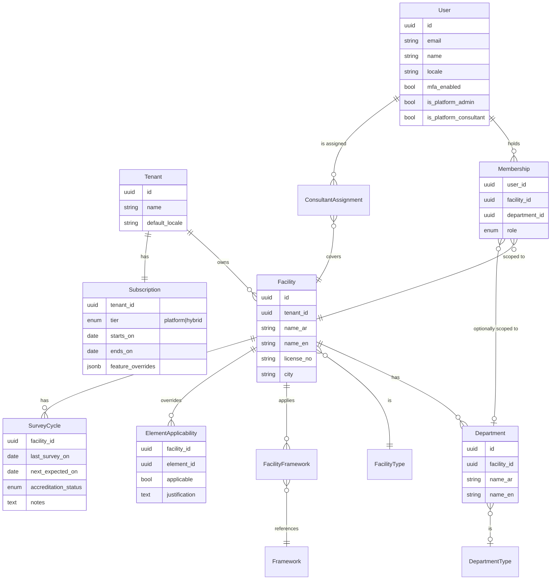
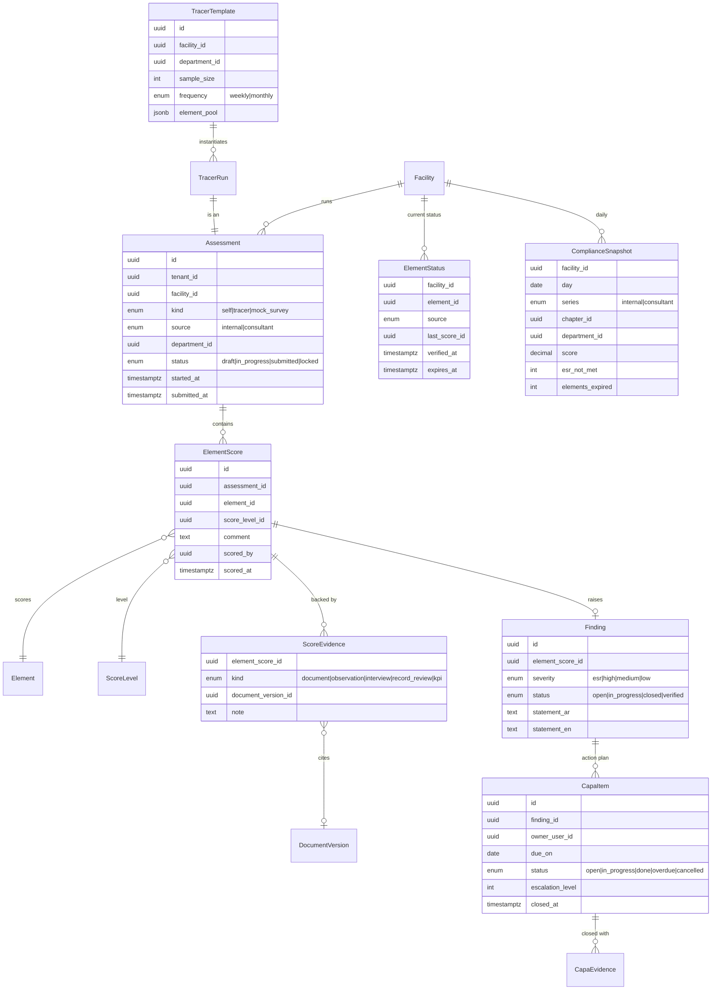
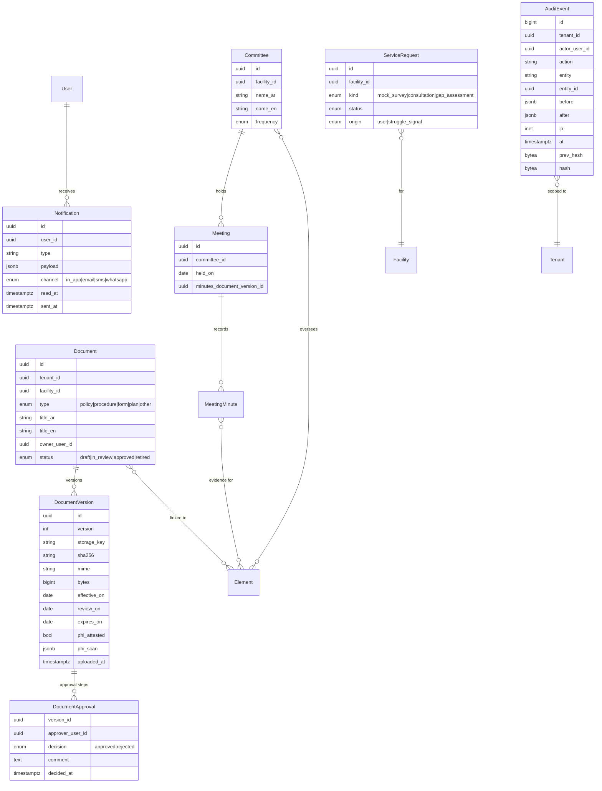

# Architecture — Continuous Compliance Platform (working name: **Mustamir / مستمر**)

> Status: **Approved** by the owner on 2026-10-19.
> "Mustamir" is a neutral placeholder name. The product name must not use the CBAHI mark, and the product must not suggest any endorsement by CBAHI.

## 0. Decisions taken (defaults adopted on the owner's instruction)

| #   | Topic               | Decision                                                                                                                                                                                                                                        |
| --- | ------------------- | ----------------------------------------------------------------------------------------------------------------------------------------------------------------------------------------------------------------------------------------------- |
| 1   | Repo & workflow     | New private repo `cbahi-compliance-platform`. One branch and one PR per milestone. The owner merges.                                                                                                                                            |
| 2   | Hosting             | The MVP runs locally on Docker. Storage, email and jobs sit behind adapters so production can go to any KSA region (GCP Dammam, Oracle Jeddah/Riyadh, STC Cloud) without code changes.                                                          |
| 3   | Stack               | Next.js 16 (App Router) + TypeScript, PostgreSQL 16 + Prisma, Better Auth (self-hosted, TOTP MFA), pg-boss jobs, next-intl, Tailwind (logical properties) + shadcn/ui, Playwright-rendered PDFs, Vitest, Playwright e2e, pnpm, docker-compose.  |
| 4   | Tenancy             | A Tenant can own many Facilities, and users can hold roles in several of them. Shared database with `tenant_id` on every tenant-owned row, enforced in two places: the repository layer **and** Postgres Row-Level Security.                    |
| 5   | Standards & scoring | Our own import schema (CSV/JSON/XLSX). Scale, weights and roll-up rules are configurable per framework. Only fictional DEMO content is seeded.                                                                                                  |
| 6   | Trend               | A daily snapshot of the _current, non-expired_ score per element. Internal scores expire after 90 days (configurable) unless re-verified. Mock-survey results are a separate series.                                                            |
| 7   | Anti-decoration     | Met or Partially Met requires evidence or a tracer observation. Upload timestamps come from the server and cannot be backdated. Consultant scores never overwrite internal scores. The internal-vs-consultant gap is shown on the dashboard.    |
| 8   | Tiers               | The super-admin assigns tiers manually (no payment gateway in the MVP). Consultants are platform staff assigned to Hybrid tenants. On-demand requests are tickets routed to the platform team.                                                  |
| 9   | Struggle signal     | Any ESR element Not Met, **or** more than 5 overdue CAPA items, **or** a survey within 90 days with readiness below 80%. All thresholds are configurable.                                                                                       |
| 10  | Demo & privacy      | The demo has fictional ambulatory-care placeholder standards only and a neutral brand. Uploads require a "no patient data" attestation plus a pattern scan of extractable text. Hijri display uses Umm al-Qura via `Intl` (`islamic-umalqura`). |

## 1. Stack and why

| Concern   | Choice                                                                                                       | Reason                                                                                                                                                                   |
| --------- | ------------------------------------------------------------------------------------------------------------ | ------------------------------------------------------------------------------------------------------------------------------------------------------------------------ |
| Web app   | **Next.js 16 App Router, TypeScript strict**                                                                 | One codebase for UI and server actions/route handlers. Server components keep data access on the server.                                                                 |
| DB        | **PostgreSQL 16**                                                                                            | RLS for defence-in-depth tenant isolation, JSONB for framework configuration, mature managed offerings in KSA regions.                                                   |
| ORM       | **Prisma**                                                                                                   | Typed models and migrations. RLS is applied through a Prisma client extension that sets `app.tenant_id` per transaction (see §5).                                        |
| Auth      | **Better Auth** (email+password, TOTP 2FA, sessions in our DB)                                               | Self-hosted, so no identity data leaves the region. Auth0 and Clerk were rejected for data-residency reasons. Authorization is **our own** RBAC (§6), not the library's. |
| Jobs      | **pg-boss**                                                                                                  | A Postgres-backed queue, so there is no Redis to operate. It handles reminders, escalations, daily snapshots and email sending.                                          |
| Files     | **S3-compatible** (SeaweedFS locally)                                                                        | Works with any regional object store. Short-lived signed URLs, server-side encryption.                                                                                   |
| Email     | SMTP adapter (Mailpit locally)                                                                               | Swappable for a regional provider.                                                                                                                                       |
| i18n      | **next-intl**, `ar` (default) and `en`                                                                       | Locale-prefixed routes (`/ar/...`, `/en/...`), ICU messages, `dir` set on `<html>`.                                                                                      |
| UI        | Tailwind with **logical properties only** (`ms-`, `pe-`, `start-`), shadcn/ui, IBM Plex Sans Arabic + Inter  | Mirrors correctly in RTL without per-component overrides.                                                                                                                |
| PDF       | HTML report → **Playwright `page.pdf()`**                                                                    | Correct Arabic shaping, bidi handling and fonts, which most JS PDF libraries get wrong.                                                                                  |
| Tests     | **Vitest** (unit and integration against a real Postgres), **Playwright** (e2e, mobile viewport for tracers) | Business rules are pure functions and easy to test. Isolation tests hit a real DB with RLS.                                                                              |
| Local dev | docker-compose: postgres, seaweedfs (S3), mailpit                                                            | `pnpm dev` + `docker compose up -d`.                                                                                                                                     |

**Deployment shape (later):** two processes from one image: `web` (Next.js) and `worker` (pg-boss consumers). Managed Postgres plus object storage in a KSA region. Secrets come from environment variables or the cloud secret manager.

## 2. Module boundaries

Modular monolith. Each module owns its tables, exposes a typed **service API**, and is the only code allowed to query its tables. UI and other modules call services, never Prisma directly.

```
src/
  app/[locale]/...            # routes (thin): parse input → call service → render
  modules/
    identity/       users, sessions, MFA, lockout (Better Auth behind it)
    tenancy/        tenants, facilities, departments, memberships, invitations, RBAC policy, onboarding progress
    standards/      frameworks, chapters, standards, elements, scales, import, facility frameworks and
                    element applicability, crosswalk (phase 2)
    assessments/    assessments, element scores, scoring & roll-up engine, readiness
    tracers/        tracer templates, schedules, runs, random sampling
    findings/       findings, CAPA items, escalation
    documents/      documents, versions, approvals, review/expiry reminders, PHI guard
    committees/     committees, meetings, minutes ↔ elements
    surveys/        survey cycle (M5), mock surveys, PDF report
    dashboards/     snapshots, trend queries, readiness overview
    notifications/  notification service + channels (in-app, email; SMS/WhatsApp later)
    subscriptions/  tiers, feature gates, consultant assignment, service requests, struggle signal
    audit/          append-only audit log
  lib/              db (Prisma + tenant context), auth, i18n, storage, jobs, dates, pdf
  worker/           job registration (imports module job handlers)
```

Each module is laid out as: `domain/` (pure functions and types, no I/O), `service.ts` (use cases, permission checks, audit), `repo.ts` (Prisma, tenant-scoped), `jobs.ts`, `ui/` (module components).

Dependency rule: `domain` imports nothing outside itself. `service` may call other modules' **services**. Cycles are forbidden, and an ESLint boundaries rule enforces this.

## 3. Data model

Conventions: UUID v7 ids. Every tenant-owned table has `tenant_id`. `created_at`, `updated_at`, `created_by` everywhere. Bilingual text is stored as paired `*_ar` / `*_en` columns (simple, indexable, and only two locales are planned). Soft delete (`archived_at`) for business records. The audit log is never deleted.

### 3.1 Standards library (global, not tenant-owned)



**As built in M4** (differences from the diagram above):

- The scoring scale belongs to the edition: `score_level.framework_id` replaces a separate `ScoringScale` table, so a later edition can change the levels without rewriting how older assessments were scored.
- Applicability and evidence types are code arrays on `element` (`evidence_types`, `facility_types`, `department_types`, GIN-indexed) validated against the `facility_type` and `department_type` catalogue tables. An empty facility list means every facility type; an empty department list means facility-wide.
- Titles are nullable per language, with a CHECK that at least one exists; the UI shows the other language with a "translation missing" badge.
- `GuidanceNote` (our own guidance per element) is deferred until a milestone needs it.
- Library tables are global. The app role has SELECT only, and RLS hides `draft` editions and their rows from it (their licence is not yet confirmed). `framework_import` is invisible to the app role.

`rollup_config` (validated with Zod) sets how scores combine at each level, for example:

```json
{
  "standard": { "method": "weighted_average", "met_threshold": 1.0, "pm_threshold": 0.5 },
  "chapter": { "method": "weighted_average" },
  "facility": { "method": "weighted_average" },
  "esr": { "allowed_levels": ["MET", "NM"], "any_not_met_blocks_readiness": true }
}
```

Supported methods: `weighted_average`, `all_must_meet`, and `threshold` (the share of child elements at or above a level). New methods are added as pure functions in `assessments/domain/rollup.ts`.

### 3.2 Tenancy, people, access



`ElementApplicability` records facility-level N/A decisions **with a justification**. A surveyor will ask why an element is N/A, so a justification is mandatory.

**As built in M5** (differences from the diagram above):

- `Facility.type` has a foreign key to the `facility_type` catalogue, and `Department.department_type` an optional one to `department_type`. The tenancy module keeps the facility-type codes as a constant list for validation; it matches the catalogue rows seeded by the M4 migration.
- `FacilityFramework`, `ElementApplicability` and `SurveyCycle` are tenant-owned (RLS policy, composite FK to the facility). The first two belong to the standards module, `SurveyCycle` to surveys. Their foreign keys to `framework` and `element` are `ON DELETE RESTRICT`, so a library edition in use cannot be deleted.
- `ElementApplicability` stores exceptions only, in both directions: "not applicable" (a DB CHECK requires a justification of at least 10 characters) and "applicable although the framework ties it to another facility type". A decision equal to the framework's rule deletes the override (rule 11).
- `SurveyCycle` is one current row per facility (status, last survey date, expected next date, notes). Dates are `DATE` columns, passed as `YYYY-MM-DD` strings so no time zone can shift them.
- Onboarding progress is two columns on `facility`: `onboarding_steps` (steps saved so far) and `onboarded_at` (set once, when the last open step is saved). The wizard is owner-only (`facility.updateSettings`) and always works on the active facility from the session. Settings links back to its steps.
- Moving a facility to a newer framework edition (and carrying its decisions across) is deferred to the milestone that first needs it; a retired edition already chosen stays selected until then.

### 3.3 Assessment, findings, CAPA



- **`ElementStatus`** is the materialized _current_ state per element and source (internal or consultant). It is updated when an assessment is submitted. A row whose `expires_at` has passed counts as **"Not verified"**: it scores 0 in readiness and is shown greyed out.
- **`ComplianceSnapshot`** is written nightly by a job. The trend chart reads only snapshots, which makes it cheap and historically honest: a later edit cannot rewrite past days.
- A **tracer run** is an `Assessment(kind=tracer)` over a random sample of the template's element pool. Sampling is weighted toward elements whose status is oldest or failing. The seed is stored for audit.
- **Mock survey** is `Assessment(kind=mock_survey, source=consultant|internal)`. Once locked, it becomes the source of the PDF report.

**As built in M7** (differences from the diagram above):

- `assessment.status` is `in_progress | submitted`. Submitting is the lock; `draft` and a separate `locked` state are not needed for self-assessment and can be added when mock surveys need them. A CHECK ties `submitted_at` to `submitted`.
- A **trigger** refuses any UPDATE or DELETE of a submitted assessment and any INSERT, UPDATE or DELETE of its scores or evidence, whatever the application does. Corrections are a new assessment.
- `element_score` stores `score_level_id` (the edition's level) with `unique(assessment_id, element_id)`. `scored_at` is server time, reset on every save.
- `score_evidence` has `kind`, `note` and `url`. Until M8 a `document` is cited by link (http or https only, opened with `rel="noopener noreferrer nofollow"`); M8 adds `document_version_id`. A CHECK requires a link for a document and a note for every other kind.
- `element_status` stores `level_code` and `element_score_id` and is unique per `(facility_id, element_id, source)`.
- `finding` lives in the `findings` module (`raiseFindings(tx, ctx, …)` runs inside the submit transaction). It stores `statement` (the scorer's comment, in the language it was written in) instead of `statement_ar`/`statement_en`, plus `element_id`, `department_id` and `level_code` so later screens need no joins through the score.
- All five tables have `tenant_id`, composite foreign keys and the `tenant_isolation` RLS policy.

**As built in M9** (differences from the diagram above):

- `capa_item.status` is `open | in_progress | done | cancelled`. **Overdue is not stored**: it follows from `due_on` and the day, so it can never be stale. `escalation_level` is computed the same way. M10 records which levels have been notified as notification dedupe keys (`capa:{id}:{due_on}:level{n}`), not as a column, so moving the due date starts the schedule afresh. `capa_item` also stores `action` (the text of the plan), `closure_note`, `closed_by`, and `department_id` copied from the finding for scoping.
- `capa_evidence` holds closure proof: `kind` `document` (an approved `document_version_id`, composite FK) or `link` (`url`), with an optional `description`.
- `finding` gains `closed_at`, `verified_at` and `verified_score_id` (the later score that proved the fix). A CHECK keeps them consistent with `status`.
- **Triggers:** an item cannot become `done` without at least one `capa_evidence` row, and the evidence of a done or cancelled item cannot be added, changed or removed until it is reopened.
- Both new tables have `tenant_id`, composite foreign keys and the `tenant_isolation` RLS policy.

**As built in M11** (differences from the diagram above):

- A tracer run is an `assessment` with `kind = tracer` and `assigned_to` (who walks it; a CHECK allows it on tracers only). Its scope is the fixed sample in `assessment_element (assessment_id, element_id)`, written when the run starts and refused afterwards by a trigger, so a run's elements cannot be swapped for easier ones.
- `tracer_template` stores `framework_id`, `department_id` (null for the whole facility), `name_ar`/`name_en` (at least one), `sample_size` (1 to 30), `frequency` (`weekly | monthly`), an optional `assignee_user_id` and `archived_at`. The pool is `tracer_template_chapter` (no rows means every chapter) instead of a jsonb list of elements, so a pool follows the facility's applicability decisions and the department's type.
- `tracer_run (assessment_id, template_id, seed, candidates, sample_size)` records the draw: the 32-hex-digit seed and every candidate with its weight at that moment. A trigger refuses any change. The run screen re-draws from these and says whether it gives back the same sample.
- All four new tables have `tenant_id`, composite foreign keys and the `tenant_isolation` RLS policy.

**As built in M13** (differences from the diagram above):

- `compliance_snapshot` holds **one row per facility, edition, day and series** (primary key `(facility_id, framework_id, day, series)`), not one row per chapter or department. The chapter and department breakdowns are `chapters` and `departments` jsonb arrays of `{id, score, counted, scored, esrNotMet, esrUnverified}` on that row. One row per day keeps the trend query to a single index range, and a breakdown always belongs to the same evaluation as its total.
- The row also stores `status` (`not_ready | at_risk | ready`), `score` (0..1, null when nothing counts), `counted`, `scored`, `esr_not_met`, `esr_unverified`, `elements_expired` and `overdue_capa`, with CHECKs on the ranges.
- **Frozen:** a trigger refuses any UPDATE, so a recorded day is never rewritten. The job inserts with `ON CONFLICT DO NOTHING`, so running it twice on a day adds nothing.
- `day` is the Riyadh calendar day. The consultant series is written only once a consultant has scored something in that edition.
- `tenant_id`, composite foreign keys and the `tenant_isolation` RLS policy, as for every tenant-owned table.

### 3.4 Documents, committees, notifications, audit



**As built in M8** (differences from the diagram above):

- `document_version.status` is `in_review | approved | rejected | superseded`; a document has no status of its own. Its state is its newest approved version (current, due for review or expired), or "retired" once `document.retired_at` is set. One version waits for review at a time, and approving one supersedes the previous approved version in the same transaction.
- `document_version` stores `file_name`, `content_type`, `bytes`, `sha256` (32 bytes), `storage_key`, the three dates, `change_note`, `phi_attested` (CHECK true), `phi_scan` (`{ scanned, hits: [{ kind, count }] }`, never the matched text) and `phi_override`. A trigger refuses any change to the file and PHI columns, any date change once decided, and any delete. `document_approval` is append-only (trigger).
- `Document }o--o{ Element` is the `document_element` table. `score_evidence.document_version_id` cites a version; links cited before M8 stay valid, and a link is still accepted for a document kept outside the platform.
- **Uploads go through the server**, not straight to the bucket with a signed PUT URL as ROADMAP M8 first said: the file must be type-checked from its bytes, hashed and scanned for PHI before it is stored, so a file that fails never reaches storage. A server action takes up to 10 MB. **Downloads** use signed GET URLs (5 minutes), minted by a route only after the permission check, at the moment of the click. Objects are written with server-side encryption under `tenants/{tenantId}/facilities/{facilityId}/documents/{documentId}/{versionId}`.

**As built in M10** (differences from the diagram above):

- `notification` has no `channel` column. It is one in-app notice per person and event, and it is **also the email outbox**: `email_status` (`pending | sent | skipped | failed`), `emailed_at`, `email_attempts`. A CHECK keeps `emailed_at` set exactly when the status is `sent`. Business code writes the notice in the same transaction as the change that caused it, so a crash after commit never loses an email: the worker's next sweep sends it.
- `priority` is `immediate | digest`, fixed by the type. `payload` is validated with a zod schema per type and holds only what the template needs (codes, titles, dates), never personal data beyond the recipient.
- `dedupe_key` is unique per `(tenant_id, user_id)`, so daily jobs can run twice, or catch up, without sending a notice twice.
- `notification_preference (tenant_id, user_id)` stores `email_immediate`, `email_digest` and an optional email `locale` (else the user's UI locale). Both tables are tenant-owned with RLS.

**As built in M12** (differences from the diagram above):

- There is no `MeetingMinute` table. Minutes are a `document` of the new type `minutes`, and `meeting.minutes_document_id` points at the document, not at one version: a correction is a new version of the same document, approved like any other, so the meeting keeps one set of minutes with its history.
- `MeetingMinute }o--o{ Element` is `document_element`: when minutes are filed they are linked, in the same transaction, to every element the committee oversees at that moment (`committee_element`). Links made later to the committee do not reach back to older minutes, which record what the committee oversaw when it met.
- `committee` has `chair_user_id` (optional), `created_by`, `archived_at` (dissolved committees leave the list; their meetings and minutes stay). `meeting` is unique per committee and day. A trigger keeps filed minutes on their meeting: once `minutes_document_id` is set it cannot change, the meeting cannot move or be deleted, and the document must be minutes of the committee's own facility.

**Phase 2 placeholders**: tables designed, not built. `KpiDefinition` / `KpiValue` (monthly) link to elements with evidence type `kpi`. `StaffCredential` (SCFHS licence, BLS/ACLS) with expiry reminders reuses the document reminder job. `Incident`. `Crosswalk(element_a, element_b, relation)`. `SeasonalCycle` (a facility with `active_from`/`active_to` and time-bounded snapshots). The benchmarking view aggregates `ElementStatus` across tenants with k-anonymity (no result for groups smaller than 5 facilities).

## 4. Core business rules (pure functions, fully unit-tested)

1. **Element score.** A level with `requires_evidence = true` (MET and PM by default) cannot be saved without at least one `ScoreEvidence`. NA at the element level needs a comment. NA does not count in the denominator.
2. **Roll-up.** Element → standard → chapter → facility uses `rollup_config`, with weights from `Standard.weight` and `Element.weight`.
3. **ESR.** ESR elements accept only MET or NM. **Any ESR element that is NM, or not verified (expired or never scored), makes the facility "Not ready", whatever the overall %.**
4. **Readiness status.** `not_ready` (ESR rule) → `at_risk` (score < 80% or more than 5 overdue CAPA items) → `ready`. Thresholds are per tenant settings with these defaults.
5. **Expiry.** An internal score expires `score_validity_days` (default 90) after `verified_at`. A consultant score does not expire, but it is shown with its date.
6. **Finding generation.** A level with `generates_finding` (NM and PM) creates a Finding automatically, with severity `esr` when the element is ESR.
7. **CAPA lifecycle.** A CAPA item cannot be set to `done` without closure evidence. When it is overdue, a job escalates it: level 1 notifies the owner, level 2 the quality manager (after 7 days), level 3 the facility owner (after 14 days). A finding closes when all its CAPA items are done. It is _verified_ only by a later score of MET on the element.
8. **Document lifecycle.** Only `approved` versions count as evidence. Reminders go out at 30, 14 and 1 days before `review_on` or `expires_on`. An expired document stops counting as evidence and flags the linked elements.
9. **Struggle signal.** See decision 9. It is evaluated nightly per Platform-tier facility and raises an in-app offer (a `ServiceRequest` draft) at most once per 14 days.
10. **Feature gates.** `can(tenant, feature)` is read from a tier matrix plus `feature_overrides`. Hybrid only: consultant assignment, consultant mock surveys, gap-assessment workflow. Everyone: all software modules.
11. **Applicability.** An element applies to a facility when its framework edition is chosen for the facility and the element's `facility_types` is empty or contains the facility's type, unless the facility recorded an override, which always wins. Ruling an element out needs a justification of at least 10 characters (a surveyor must be able to check it). ESR elements may be ruled out, but the screen counts and flags them. A decision that matches the framework's own rule clears the override. Frameworks are suggested from the facility type (`suggestedPrograms`), and the owner confirms them. (`standards/domain/applicability.ts`)
12. **Survey cycle.** A facility that was never surveyed has no last-survey date; any other status needs one, not in the future. The next expected survey must come after the last one and is suggested three years later (29 February rolls to 28 February). (`surveys/domain/survey-cycle.ts`)

**As built in M6** (`src/modules/assessments/domain/`, pure functions, no tables yet; the tables arrive with M7):

- _Scale._ Roll-up works on each level as a fraction of the scale's top counting level, so an edition may use any values (1/0.5/0, 2/1/0, 100/50/0). A level with `counts_in_denominator = false` (NA) drops the element out.
- _Element score (rule 1)._ Problems are reported together: `unknownLevel`, `elementNotApplicable` (an element the facility ruled out in M5 cannot be scored; that decision is made once, with a justification), `esrLevelNotAllowed` (ESR levels come from `rollup_config.esr.allowed_levels`), `evidenceRequired`, and `commentRequired` for an element-level NA.
- _Roll-up (rule 2)._ An applicable element with no current score (never scored, or expired) counts as **0**, not as missing: compliance nobody has verified recently cannot be claimed, and a surveyor scores every applicable element. Coverage is reported beside the score (`counted`, `scored`). `weighted_average` is Σw·s/Σw; `all_must_meet` is 1 only when every child is fully met, else 0; `threshold` maps the weighted share of fully met children to 1 at or above `met_threshold`, 0.5 at or above `pm_threshold`, else 0 (the standard's thresholds are used at every level). Children with no score or weight 0 take no part. At facility level a chapter weighs the sum of its standards' weights, so a small chapter does not outvote a large one.
- _ESR (rule 3)._ "Not met" means an ESR element scored below full compliance; "not verified" means never scored or expired. Either makes the facility `not_ready`. If an edition sets `any_not_met_blocks_readiness = false`, they make it `at_risk` instead.
- _Readiness (rule 4)._ `ready` needs a score of at least `readyScore` (default 0.8, inclusive) and at most `maxOverdueCapa` (default 5) overdue CAPA items. With nothing to score it is `at_risk`. The reasons are returned with the status.
- _Expiry (rule 5)._ Runs from when the score was recorded (server time), not from when the assessment was submitted: an observation is as old as the day it was made. Expired from the expiry instant on. The validity is a positive whole number of days.
- _ElementStatus._ One row per element **per source**, so a consultant score never replaces an internal one (decision 7). A submitted score replaces the status unless the status comes from a newer score, so submitting an old draft late cannot roll an element back. `evaluateFacility` chains current levels → roll-up → readiness for one series at a given `now`.

**As built in M7** (`assessments/domain/assessment.ts`, `findings/domain/severity.ts`, `assessments/service.ts`):

- _Scope._ A whole-facility assessment covers every applicable element. A department assessment covers the applicable elements whose `department_types` include the department's type; facility-wide elements (no department types) stay with the whole-facility assessment, so a department head never answers for governance they do not run. A department with no type, or no element of its type, cannot be assessed (`nothingToScore`).
- _Saving a score._ The score is saved with any new evidence, then rule 1 is checked against what is stored, so evidence added earlier counts; a broken rule rolls the save back. Evidence of a level that requires it cannot be removed down to none.
- _Submit._ Every element in scope must be scored (`incomplete`), because a surveyor scores every applicable element. Submitting writes `ElementStatus` (rule above), raises the findings and locks the assessment in one transaction.
- _Finding severity (rule 6)._ `esr` for an ESR element; otherwise `high` when the level has no compliance (normalized 0) and `medium` for partial compliance. `low` is left for findings raised by hand.
- _Readiness._ The dashboard evaluates the internal series per edition the facility uses, as of now. Score validity is the default 90 days until per-tenant settings arrive.
- _Who._ Scoring follows `assessment.score` (owner and quality manager facility-wide, department head for their own department). Anyone with `dashboard.view` for the scope can read an assessment and its findings; facility-level readiness needs facility-wide `dashboard.view`.

**As built in M11** (`tracers/domain/`, `tracers/service.ts`):

- _Sampling._ Each candidate gets a weight: 4 when never verified or expired, 3 when its current score is short of full compliance, and from 1 to 2 when met, rising with the age of the check up to the score's validity. A known gap therefore always outweighs a stale compliant check. The draw is weighted sampling without replacement (Efraimidis–Spirakis, keys `ln(u)/w`) on a seeded 128-bit generator, ordered by element id, so the same seed and candidates always give the same sample. A pool smaller than the sample is taken whole.
- _Schedule._ A template is due on the day it is made, then one period (7 days, or one calendar month kept to the month's last day) after its last run started. It is overdue once a further whole period passes without a run. One run per template is open at a time.
- _Results._ A run is scored like any assessment (rule 1: Met and Partially Met need evidence, here an observation, interview or record review), and submitting it updates `ElementStatus`, raises findings and verifies closed ones exactly as a self-assessment does. Every sampled element must be checked before submitting.
- _Who._ `tracer.manage` (owner and quality manager facility-wide, department head for their department) creates and archives templates. `tracer.run` adds the assignee: a staff member assigned to a template can start and walk its runs. A run started by a manager is assigned to the template's assignee if there is one. Self-assessment lists leave tracer runs out; they have their own screen.

**As built in M12** (`committees/domain/`, `committees/service.ts`):

- _Schedule._ Frequencies are monthly, quarterly, every six months and yearly. The next meeting is due one period after the last meeting held (calendar months, kept to the last day of a shorter month), or one period after the committee was formed if it has not met. It shows as due soon from 14 days before and overdue from the day after. Only meetings that took place are recorded: a date after today (Riyadh) is refused.
- _Minutes as evidence._ Filing minutes creates a facility-wide `minutes` document through document control (attestation, PHI scan, approval), in force from the meeting day and linked to the overseen elements. Once approved, the minutes are a citable version for those elements under rule 8, offered first in the score form like any linked document. One set of minutes per meeting; a meeting with minutes cannot be deleted.
- _Who._ `committee.manage` (owner and quality manager, facility-wide) creates, edits and dissolves committees, chooses the elements they oversee, records meetings and files minutes. Approving minutes follows `document.approve`. Every member of the facility can read committees and meetings. Meeting reminders are not built.

**As built in M13** (`assessments/domain/compliance.ts`, `dashboards/domain/`, `dashboards/service.ts`, `dashboards/jobs.ts`):

- _Breakdown._ `complianceBreakdown` evaluates one series of a facility as of `now` (rules 2 to 5) and adds per-chapter and per-department scores. A department is scored on exactly the elements a department self-assessment would cover (its type's elements), so the two never disagree; a department with no such elements has no score.
- _Snapshot._ The `snapshots` job runs at 23:50 Riyadh time and records the day's internal series per facility and edition, plus the consultant series once there is one. Scores are rounded to 5 decimals.
- _Overview._ Per edition: readiness with its reasons and a "Not ready" banner, the ESR elements not met or not verified, scores by chapter and department, and the elements without a current score (ESR first, the first 10 named and the rest counted). Facility-wide: open and overdue CAPA, documents expiring within 30 days, expired and due for review, the elements whose current score cites a document version that has since expired (rule 8, computed from dates), and the survey countdown.
- _Survey countdown._ From the survey cycle's expected date: `soon` within 90 days, `imminent` within 30, `passed` once the date is behind (the cycle needs updating), `unknown` without a date.
- _Trend._ The last 180 days of snapshots, internal and consultant on one percentage axis with the readiness threshold drawn. Time runs left to right in both languages. Values are also given as a table.
- _Who._ Facility-wide `dashboard.view` (owner, quality manager, consultant, viewer) sees everything. A department head or staff member sees only the scores of their own departments: no facility readiness, trend or facility tiles, because readiness is a facility-level verdict.

**As built in M8** (`documents/domain/`, `documents/service.ts`):

- _Document lifecycle (rule 8)._ An approved version is _current_, _due for review_ from its review date (still in force: review is a reminder), and _expired_ the day after its expiry date (a cut-off). Only a current or review-due version of a document that is not retired can be cited; an expired one is refused. Dates must run effective → review → expiry. A rejection needs a comment. Uploaders may approve their own version; the audit event records `selfApproved` so a reviewer can see it. Review and expiry reminders arrive with the notification jobs (M10): review-due and expiring-soon (30 days before expiry) go into the daily digest, and expiry is an immediate notice, to the document owner, quality managers and facility owners. Showing the elements whose cited document has expired moves to the M13 readiness view, which computes it from the dates rather than storing a flag.
- _Files._ The type comes from the file's bytes (PDF, Word, Excel, PNG, JPEG), not its name. The same file cannot be uploaded twice to one document (SHA-256).
- _PHI guard (decision 10)._ Every upload needs the attestation. Text is extracted from PDF and Word files and scanned for a 10-digit national ID or Iqama number (starting 1 or 2, Arabic-Indic digits included), a medical-record or patient number after its label, and a date after a date-of-birth label. A match stops the upload until the uploader confirms the file holds no patient data; the confirmation is audited (`phi_override`, kinds and counts only). Images and spreadsheets are not scanned; the attestation covers them.
- _Who._ `document.upload` and `document.approve` per the matrix in §6; linking follows upload, retiring follows approve. Every member of the facility can read its documents and download them.

**As built in M9** (`findings/domain/capa.ts`, `findings/service.ts`):

- _CAPA lifecycle (rule 7)._ `start` (open → in progress), `complete` (open or in progress → done; needs evidence and a closure note), `cancel` (needs a reason) and `reopen` (done → in progress; needs a reason, refused once the finding is verified). A due date is never in the past when set or moved; moving it needs a reason, kept in the audit log. Evidence is an approved document version in force (rule 8) or an http(s) link.
- _Finding status._ Derived from its actions on every change: `open` with no live (non-cancelled) action, `closed` when every live action is done, `in_progress` otherwise. `verified` is final.
- _Verification._ Submitting an assessment verifies each `closed` finding on an element it scores at full compliance (normalized 1) with a score saved after the finding closed. A department assessment verifies only that department's findings; a facility-wide one verifies any. A finding that is still open is not verified by a good score: its actions must be closed first.
- _Escalation schedule._ Level 1 from the first day overdue (the owner), level 2 from 7 days (adds the quality manager), level 3 from 14 days (adds the facility owner). M9 shows the level on the action; M10 sends the notices, each level once, and a job that missed days catches up by sending every level reached.
- _Readiness._ Overdue actions are counted across the facility for rule 4.
- _Who._ Planning (create, reschedule, cancel, reopen) follows `capa.create` for the finding's scope. Starting, adding evidence and completing are for the owner (`capa.closeOwn`) or a planner; the audit event records `closedByOwner`. An action's owner can read its finding even outside their department. Owners must be members of the facility with a role other than viewer.

## 5. Multi-tenancy and isolation

- **Layer 1, application:** each request resolves a `TenantContext { tenantId, userId, facilityIds, roles }` from the session. Repositories take the context and always filter by `tenant_id`. There is no raw Prisma access outside `repo.ts` files (lint rule).
- **Layer 2, database:** RLS is enabled and forced on every tenant-owned table with the policy `tenant_id = app_current_tenant()`, which reads `app.tenant_id` and returns NULL (no rows) when it is unset. `withTenant()` in `src/lib/db.ts` wraps each unit of work in a transaction that runs `SELECT set_config('app.tenant_id', $1, true)`. Four database roles keep privilege low: `mustamir_app` (the app, no `BYPASSRLS`, cannot write `subscription` or change `audit_event`, cannot read the auth tables), `mustamir_auth` (Better Auth and the identity module only: `app_user` and the `auth_*` tables, nothing tenant-owned), `mustamir_system` (`BYPASSRLS`, used through `withSystem()` for platform-admin work and cross-tenant jobs, always audited), and the schema owner (migrations only). `app_user` is global, but a tenant sees only users who hold a membership in it. Before a request knows its tenant, `withoutTenant()` runs as the app role with no tenant set, where only two `SECURITY DEFINER` lookups return data: a user's own memberships (`app_user_memberships`, keyed by the verified session's user id) and an invitation by the hash of its secret token (`app_find_invitation`). Foreign keys between tenant-owned tables are composite (`tenant_id, id`), so a row can never reference another tenant's row.
- **Consultants** are platform users. They receive a scoped context only for facilities with an active `ConsultantAssignment` on a Hybrid tenant.
- **Storage keys** are prefixed `tenants/{tenantId}/facilities/{facilityId}/...`. A signed URL is issued only after a service-level permission check, and it lasts 5 minutes.
- **Tests:** an isolation suite creates two tenants and asserts that every repository and every route handler returns nothing, and cannot write anything, across the boundary. It also covers raw SQL under RLS.

## 6. Security model

**Roles** (per facility `Membership`, optionally narrowed to a department):

| Permission                             | Owner | Quality mgr | Dept head | Staff        | Consultant*   | Viewer |
| -------------------------------------- | ----- | ----------- | --------- | ------------ | ------------- | ------ |
| Facility settings, users, subscription | ✓     | users only  | –         | –            | –             | –      |
| Self-assessment: score                 | ✓     | ✓           | own dept  | –            | –             | –      |
| Tracer: run                            | ✓     | ✓           | own dept  | ✓ (assigned) | –             | –      |
| Tracer: templates                      | ✓     | ✓           | own dept  | –            | –             | –      |
| Mock survey: run and lock              | –     | internal    | –         | –            | ✓             | –      |
| Committees: manage, record meetings    | ✓     | ✓           | –         | –            | –             | –      |
| Documents: upload                      | ✓     | ✓           | own dept  | ✓            | –             | –      |
| Documents: approve                     | ✓     | ✓           | –         | –            | –             | –      |
| CAPA: create and assign                | ✓     | ✓           | own dept  | –            | ✓ (recommend) | –      |
| CAPA: close own item                   | ✓     | ✓           | ✓         | ✓            | –             | –      |
| Dashboards and reports                 | ✓     | ✓           | own dept  | own dept     | ✓             | ✓      |
| Audit log view                         | ✓     | ✓           | –         | –            | –             | –      |

\* Only on assigned Hybrid facilities. The platform super-admin manages frameworks, tiers and assignments and has no default access to tenant data. Support access must be granted explicitly per tenant and is time-limited and audited.

The policy lives in one place, `tenancy/domain/policy.ts`, as `can(ctx, action, resource)`. It is covered by a table-driven test that mirrors this matrix. "Own dept" means the record's department equals the department on the membership; a record with no department (facility-wide) is out of scope for a department-scoped role.

**Granting roles** never raises anyone above the granter: an owner can grant every role, a quality manager can grant department head, staff and viewer only (appointing a quality manager or an owner is a leadership decision), and nobody else can grant roles (`assignableRoles`).

**Invitations** (tenancy module): an invitation is a one-time link into one facility role, valid for 7 days. Only a SHA-256 hash of the token is stored. Re-inviting the same person to the same role revokes the earlier link. Whoever accepts must be signed in with the invited email (case-insensitive), which also marks that email verified. Someone who signs up without an invitation creates their own organization and becomes owner of its first facility (`createOrganization`, allowed only while they belong to no facility); the tier starts as Platform and is changed by the super-admin.

**Other controls**

- MFA (TOTP) is **required** for owner, quality manager, consultant and super-admin, and optional for others. The app sends such a user to enrolment before any page renders; enrolment shows 10 single-use backup codes. Session idle timeout is 30 minutes (sliding, refreshed at most every 5 minutes) and absolute timeout 12 hours from sign-in. Passwords are 12–128 characters, hashed with argon2id (m=19 MiB, t=2, p=1). Five wrong passwords in a row lock the account for 15 minutes (further attempts do not extend the lock, so an attacker cannot keep a user out indefinitely); wrong TOTP codes have their own lockout (10 attempts, 15 minutes). Auth endpoints are rate-limited per client IP. Sign-ins and lockouts are written to the audit log of every tenant the user belongs to.
- **Encryption:** TLS everywhere, Postgres storage encryption, and server-side encryption on the object store. Files are never served from a public bucket.
- **Audit log:** an append-only `audit_event` table. A DB trigger rejects UPDATE and DELETE. Each row stores a SHA-256 hash chained to the previous row per tenant, and a verification command checks the chain. It covers scores, evidence, approvals, CAPA status, role changes, exports and logins.
- **PDPL and data minimization:** no patient fields exist anywhere in the schema. Uploads require an attestation checkbox. The server extracts text (PDF and DOCX) and scans it for Saudi national ID or Iqama numbers (10 digits starting with 1 or 2), MRN or medical-record labels, and dates of birth near names. A hit blocks the upload until the user confirms the content is redacted, and the confirmation is audited. Data processing records and a retention policy are kept per tenant, and tenant data can be exported or deleted.
- **NCA ECC alignment** (design-level): least privilege, centralized logging, backups, vulnerability scanning in CI (`pnpm audit`, CodeQL), and a secrets policy (no secrets in the repo, `.env.example` only).
- **Security headers:** strict CSP, HSTS, `frame-ancestors 'none'`, and SameSite=Lax cookies plus CSRF protection on mutations.

## 7. i18n, RTL and dates

- `ar` is the default and the first locale. All UI strings live in `messages/{ar,en}.json`. A CI check fails when the two files have different keys.
- `<html lang dir>` is set from the locale. Only logical Tailwind utilities are used, and icons that imply direction (arrows, chevrons) flip with `rtl:` variants.
- Mixed-direction text (codes such as `DEMO-LD.1.2` inside Arabic) is wrapped in `<bdi>`. Numbers use Latin digits by default, with Arabic-Indic digits as a user preference.
- Dates are stored in UTC and displayed in `Asia/Riyadh`. Gregorian is the default. A user preference adds the Hijri date (Umm al-Qura) next to it via `Intl.DateTimeFormat('ar-SA-u-ca-islamic-umalqura')`.
- Imported standards text is shown in the user's locale. If that translation is missing, the other language is shown with a "translation missing" badge.

## 8. Notifications

`notifications.notify(tx, ctx, notices)` stores in-app notices inside the caller's transaction. Each notice carries a `dedupeKey`; a duplicate is ignored. Templates are per type and per locale (`notifications.types.*` in the message files) and are rendered when shown or emailed, so a notice reads in whichever language the reader uses.

**As built in M10:**

- **Types and priority.** `capaAssigned`, `capaOverdue` and `documentExpired` are immediate. `documentReviewDue` and `documentExpiring` go into the daily digest.
- **Email.** Every minute, `deliver` claims pending immediate notices (`FOR UPDATE SKIP LOCKED`) and emails each one, unless the person turned immediate email off (it then waits for the digest) or turned all email off (skipped). At 07:00 Riyadh, `digest` sends each person one email listing all their still-pending notices. A notice already read in the app is not emailed. A send error is retried on later sweeps, up to 3 attempts, then marked `failed`.
- **Jobs.** `reminders` runs at 06:00 Riyadh: document review and expiry reminders, then CAPA escalation. Each job reads the tenant list through the system role, then works tenant by tenant inside `withTenant`, so RLS still applies. One tenant's error does not stop the others.
- **Worker.** `pnpm worker` runs pg-boss (schema `pgboss`, created by the migration because the system role cannot create schemas) with the three cron schedules. `pnpm jobs:run <job>... [--now ISO]` runs jobs once without the queue, for catching up after downtime and for tests with a fake clock.
- **Channels.** In-app and email (SMTP via `lib/email`). `SmsChannel` and `WhatsAppChannel` are stubs that report "not configured"; no phone numbers are stored until a KSA provider and a PDPL basis for holding staff numbers are agreed.
- **UI.** A bell in the header with the unread count, an inbox at `/notifications` (opening a notice marks it read), and per-person email preferences on the same page.

## 9. Standards import

`standards/import` accepts CSV, XLSX or JSON in our documented schema (`docs/IMPORT_FORMAT.md`, written in milestone M4). The flow is upload, validate (Zod, with row-level errors), preview a diff against the current edition, and commit as a **new framework edition** in `draft` status, which an admin then activates. A framework cannot be activated without a `license_note` (also a DB CHECK), and a partial unique index allows one live edition per code; activating a draft retires the previous live edition in the same transaction. Retired editions stay readable for past assessments. Valid uploads are staged in `framework_import` with their report, so the admin commits exactly what was previewed; files with errors are never stored. Only the platform admin imports (`/{locale}/platform/standards`, MFA required); the flag is granted from the command line with `pnpm platform:admin <email>` and audited. Library writes go through the system role and are written to the platform audit chain. The repo seeds only `DEMO-*` placeholder content (`pnpm db:seed`).

## 10. Testing strategy

- **Unit (Vitest):** everything in `*/domain`. That covers scoring, roll-up, ESR and readiness, expiry, CAPA transitions, escalation schedule, feature gates, the struggle signal, the policy matrix, tracer sampling and the PHI scanner.
- **Integration (Vitest + real Postgres in Docker):** repositories, RLS, tenant isolation, audit immutability and import.
- **E2E (Playwright):** the definition-of-done journeys in Arabic and English, with tracers on a mobile viewport (Pixel 7). Axe accessibility checks run on key pages.
- CI (GitHub Actions) runs lint, typecheck, unit, integration and e2e on every PR.
