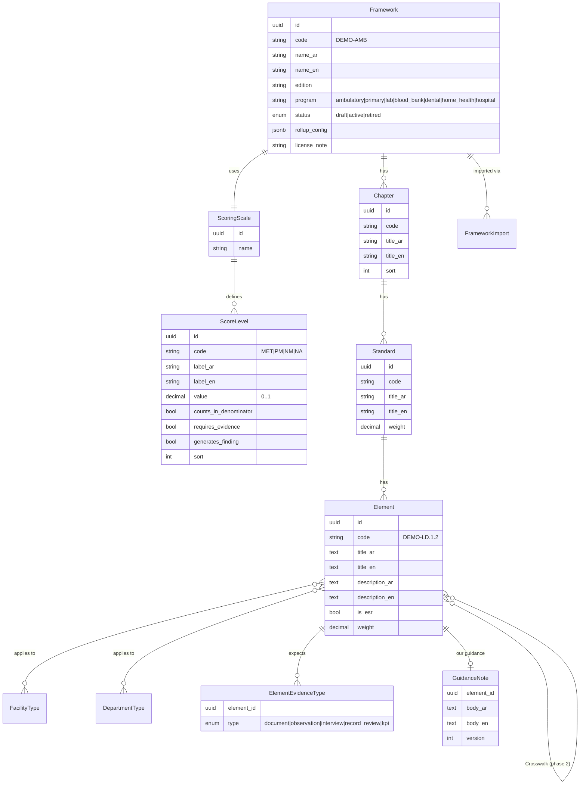
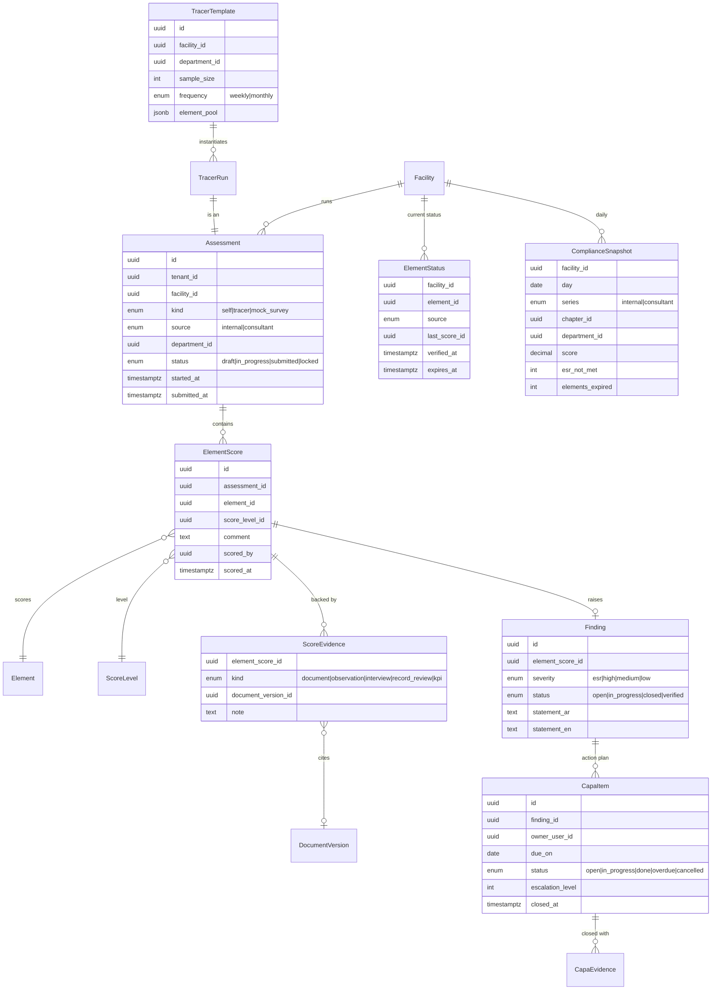
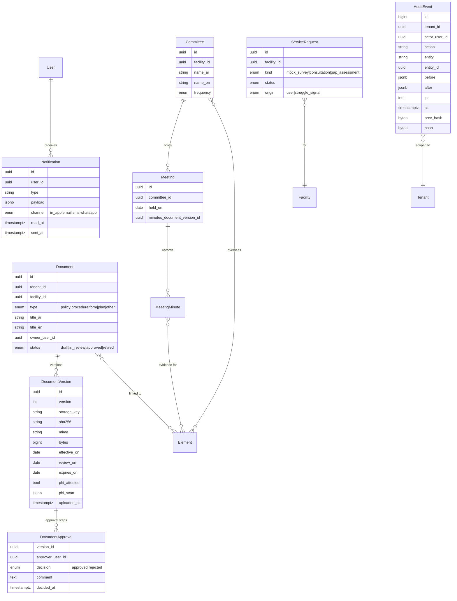

# Architecture — Continuous Compliance Platform (working name: **Mustamir / مستمر**)

> Status: **Approved** by the owner on 2026-10-19.
> "Mustamir" is a neutral placeholder name. The product name must not use the CBAHI mark, and the product must not suggest any endorsement by CBAHI.

## 0. Decisions taken (defaults adopted on the owner's instruction)

| #   | Topic               | Decision                                                                                                                                                                                                                                        |
| --- | ------------------- | ----------------------------------------------------------------------------------------------------------------------------------------------------------------------------------------------------------------------------------------------- |
| 1   | Repo & workflow     | New private repo `cbahi-compliance-platform`. One branch and one PR per milestone. The owner merges.                                                                                                                                            |
| 2   | Hosting             | The MVP runs locally on Docker. Storage, email and jobs sit behind adapters so production can go to any KSA region (GCP Dammam, Oracle Jeddah/Riyadh, STC Cloud) without code changes.                                                          |
| 3   | Stack               | Next.js 16 (App Router) + TypeScript, PostgreSQL 16 + Prisma, Better Auth (self-hosted, TOTP MFA), pg-boss jobs, next-intl, Tailwind (logical properties) + shadcn/ui, Playwright-rendered PDFs, Vitest, Playwright e2e, pnpm, docker-compose.  |
| 4   | Tenancy             | A Tenant can own many Facilities, and users can hold roles in several of them. Shared database with `tenant_id` on every tenant-owned row, enforced in two places: the repository layer **and** Postgres Row-Level Security.                    |
| 5   | Standards & scoring | Our own import schema (CSV/JSON/XLSX). Scale, weights and roll-up rules are configurable per framework. Only fictional DEMO content is seeded.                                                                                                  |
| 6   | Trend               | A daily snapshot of the _current, non-expired_ score per element. Internal scores expire after 90 days (configurable) unless re-verified. Mock-survey results are a separate series.                                                            |
| 7   | Anti-decoration     | Met or Partially Met requires evidence or a tracer observation. Upload timestamps come from the server and cannot be backdated. Consultant scores never overwrite internal scores. The internal-vs-consultant gap is shown on the dashboard.    |
| 8   | Tiers               | The super-admin assigns tiers manually (no payment gateway in the MVP). Consultants are platform staff assigned to Hybrid tenants. On-demand requests are tickets routed to the platform team.                                                  |
| 9   | Struggle signal     | Any ESR element Not Met, **or** more than 5 overdue CAPA items, **or** a survey within 90 days with readiness below 80%. All thresholds are configurable.                                                                                       |
| 10  | Demo & privacy      | The demo has fictional ambulatory-care placeholder standards only and a neutral brand. Uploads require a "no patient data" attestation plus a pattern scan of extractable text. Hijri display uses Umm al-Qura via `Intl` (`islamic-umalqura`). |

## 1. Stack and why

| Concern   | Choice                                                                                                       | Reason                                                                                                                                                                   |
| --------- | ------------------------------------------------------------------------------------------------------------ | ------------------------------------------------------------------------------------------------------------------------------------------------------------------------ |
| Web app   | **Next.js 16 App Router, TypeScript strict**                                                                 | One codebase for UI and server actions/route handlers. Server components keep data access on the server.                                                                 |
| DB        | **PostgreSQL 16**                                                                                            | RLS for defence-in-depth tenant isolation, JSONB for framework configuration, mature managed offerings in KSA regions.                                                   |
| ORM       | **Prisma**                                                                                                   | Typed models and migrations. RLS is applied through a Prisma client extension that sets `app.tenant_id` per transaction (see §5).                                        |
| Auth      | **Better Auth** (email+password, TOTP 2FA, sessions in our DB)                                               | Self-hosted, so no identity data leaves the region. Auth0 and Clerk were rejected for data-residency reasons. Authorization is **our own** RBAC (§6), not the library's. |
| Jobs      | **pg-boss**                                                                                                  | A Postgres-backed queue, so there is no Redis to operate. It handles reminders, escalations, daily snapshots and email sending.                                          |
| Files     | **S3-compatible** (SeaweedFS locally)                                                                        | Works with any regional object store. Short-lived signed URLs, server-side encryption.                                                                                   |
| Email     | SMTP adapter (Mailpit locally)                                                                               | Swappable for a regional provider.                                                                                                                                       |
| i18n      | **next-intl**, `ar` (default) and `en`                                                                       | Locale-prefixed routes (`/ar/...`, `/en/...`), ICU messages, `dir` set on `<html>`.                                                                                      |
| UI        | Tailwind with **logical properties only** (`ms-`, `pe-`, `start-`), shadcn/ui, IBM Plex Sans Arabic + Inter  | Mirrors correctly in RTL without per-component overrides.                                                                                                                |
| PDF       | HTML report → **Playwright `page.pdf()`**                                                                    | Correct Arabic shaping, bidi handling and fonts, which most JS PDF libraries get wrong.                                                                                  |
| Tests     | **Vitest** (unit and integration against a real Postgres), **Playwright** (e2e, mobile viewport for tracers) | Business rules are pure functions and easy to test. Isolation tests hit a real DB with RLS.                                                                              |
| Local dev | docker-compose: postgres, seaweedfs (S3), mailpit                                                            | `pnpm dev` + `docker compose up -d`.                                                                                                                                     |

**Deployment shape (later):** two processes from one image: `web` (Next.js) and `worker` (pg-boss consumers). Managed Postgres plus object storage in a KSA region. Secrets come from environment variables or the cloud secret manager.

## 2. Module boundaries

Modular monolith. Each module owns its tables, exposes a typed **service API**, and is the only code allowed to query its tables. UI and other modules call services, never Prisma directly.

```
src/
  app/[locale]/...            # routes (thin): parse input → call service → render
  modules/
    identity/       users, sessions, MFA, lockout (Better Auth behind it)
    tenancy/        tenants, facilities, departments, memberships, invitations, RBAC policy
    standards/      frameworks, chapters, standards, elements, scales, import, crosswalk (phase 2)
    assessments/    assessments, element scores, scoring & roll-up engine, readiness
    tracers/        tracer templates, schedules, runs, random sampling
    findings/       findings, CAPA items, escalation
    documents/      documents, versions, approvals, review/expiry reminders, PHI guard
    committees/     committees, meetings, minutes ↔ elements
    surveys/        survey cycles, mock surveys, PDF report
    dashboards/     snapshots, trend queries, readiness overview
    notifications/  notification service + channels (in-app, email; SMS/WhatsApp later)
    subscriptions/  tiers, feature gates, consultant assignment, service requests, struggle signal
    audit/          append-only audit log
  lib/              db (Prisma + tenant context), auth, i18n, storage, jobs, dates, pdf
  worker/           job registration (imports module job handlers)
```

Each module is laid out as: `domain/` (pure functions and types, no I/O), `service.ts` (use cases, permission checks, audit), `repo.ts` (Prisma, tenant-scoped), `jobs.ts`, `ui/` (module components).

Dependency rule: `domain` imports nothing outside itself. `service` may call other modules' **services**. Cycles are forbidden, and an ESLint boundaries rule enforces this.

## 3. Data model

Conventions: UUID v7 ids. Every tenant-owned table has `tenant_id`. `created_at`, `updated_at`, `created_by` everywhere. Bilingual text is stored as paired `*_ar` / `*_en` columns (simple, indexable, and only two locales are planned). Soft delete (`archived_at`) for business records. The audit log is never deleted.

### 3.1 Standards library (global, not tenant-owned)



`rollup_config` (validated with Zod) sets how scores combine at each level, for example:

```json
{
  "standard": { "method": "weighted_average", "met_threshold": 1.0, "pm_threshold": 0.5 },
  "chapter": { "method": "weighted_average" },
  "facility": { "method": "weighted_average" },
  "esr": { "allowed_levels": ["MET", "NM"], "any_not_met_blocks_readiness": true }
}
```

Supported methods: `weighted_average`, `all_must_meet`, and `threshold` (the share of child elements at or above a level). New methods are added as pure functions in `assessments/domain/rollup.ts`.

### 3.2 Tenancy, people, access

```mermaid
erDiagram
  Tenant ||--o{ Facility : owns
  Tenant ||--|| Subscription : has
  Facility ||--o{ Department : has
  Facility }o--|| FacilityType : is
  Facility ||--o{ FacilityFramework : "applies"
  FacilityFramework }o--|| Framework : references
  Department }o--o| DepartmentType : is
  User ||--o{ Membership : holds
  Membership }o--|| Facility : "scoped to"
  Membership }o--o| Department : "optionally scoped to"
  User ||--o{ ConsultantAssignment : "is assigned"
  ConsultantAssignment }o--|| Facility : covers
  Facility ||--o{ ElementApplicability : overrides
  Facility ||--o{ SurveyCycle : has

  Tenant { uuid id  string name  string default_locale }
  Subscription { uuid tenant_id  enum tier "platform|hybrid"  date starts_on  date ends_on  jsonb feature_overrides }
  Facility { uuid id  uuid tenant_id  string name_ar  string name_en  string license_no  string city }
  Department { uuid id  uuid facility_id  string name_ar  string name_en }
  User { uuid id  string email  string name  string locale  bool mfa_enabled  bool is_platform_admin  bool is_platform_consultant }
  Membership { uuid user_id  uuid facility_id  uuid department_id  enum role }
  ElementApplicability { uuid facility_id  uuid element_id  bool applicable  text justification }
  SurveyCycle { uuid facility_id  date last_survey_on  date next_expected_on  enum accreditation_status  text notes }
```



`ElementApplicability` records facility-level N/A decisions **with a justification**. A surveyor will ask why an element is N/A, so a justification is mandatory.

### 3.3 Assessment, findings, CAPA



- **`ElementStatus`** is the materialized _current_ state per element and source (internal or consultant). It is updated when an assessment is submitted. A row whose `expires_at` has passed counts as **"Not verified"**: it scores 0 in readiness and is shown greyed out.
- **`ComplianceSnapshot`** is written nightly by a job. The trend chart reads only snapshots, which makes it cheap and historically honest: a later edit cannot rewrite past days.
- A **tracer run** is an `Assessment(kind=tracer)` over a random sample of the template's element pool. Sampling is weighted toward elements whose status is oldest or failing. The seed is stored for audit.
- **Mock survey** is `Assessment(kind=mock_survey, source=consultant|internal)`. Once locked, it becomes the source of the PDF report.

### 3.4 Documents, committees, notifications, audit



**Phase 2 placeholders**: tables designed, not built. `KpiDefinition` / `KpiValue` (monthly) link to elements with evidence type `kpi`. `StaffCredential` (SCFHS licence, BLS/ACLS) with expiry reminders reuses the document reminder job. `Incident`. `Crosswalk(element_a, element_b, relation)`. `SeasonalCycle` (a facility with `active_from`/`active_to` and time-bounded snapshots). The benchmarking view aggregates `ElementStatus` across tenants with k-anonymity (no result for groups smaller than 5 facilities).

## 4. Core business rules (pure functions, fully unit-tested)

1. **Element score.** A level with `requires_evidence = true` (MET and PM by default) cannot be saved without at least one `ScoreEvidence`. NA at the element level needs a comment. NA does not count in the denominator.
2. **Roll-up.** Element → standard → chapter → facility uses `rollup_config`, with weights from `Standard.weight` and `Element.weight`.
3. **ESR.** ESR elements accept only MET or NM. **Any ESR element that is NM, or not verified (expired or never scored), makes the facility "Not ready", whatever the overall %.**
4. **Readiness status.** `not_ready` (ESR rule) → `at_risk` (score < 80% or more than 5 overdue CAPA items) → `ready`. Thresholds are per tenant settings with these defaults.
5. **Expiry.** An internal score expires `score_validity_days` (default 90) after `verified_at`. A consultant score does not expire, but it is shown with its date.
6. **Finding generation.** A level with `generates_finding` (NM and PM) creates a Finding automatically, with severity `esr` when the element is ESR.
7. **CAPA lifecycle.** A CAPA item cannot be set to `done` without closure evidence. When it is overdue, a job escalates it: level 1 notifies the owner, level 2 the quality manager (after 7 days), level 3 the facility owner (after 14 days). A finding closes when all its CAPA items are done. It is _verified_ only by a later score of MET on the element.
8. **Document lifecycle.** Only `approved` versions count as evidence. Reminders go out at 30, 14 and 1 days before `review_on` or `expires_on`. An expired document stops counting as evidence and flags the linked elements.
9. **Struggle signal.** See decision 9. It is evaluated nightly per Platform-tier facility and raises an in-app offer (a `ServiceRequest` draft) at most once per 14 days.
10. **Feature gates.** `can(tenant, feature)` is read from a tier matrix plus `feature_overrides`. Hybrid only: consultant assignment, consultant mock surveys, gap-assessment workflow. Everyone: all software modules.

## 5. Multi-tenancy and isolation

- **Layer 1, application:** each request resolves a `TenantContext { tenantId, userId, facilityIds, roles }` from the session. Repositories take the context and always filter by `tenant_id`. There is no raw Prisma access outside `repo.ts` files (lint rule).
- **Layer 2, database:** RLS is enabled and forced on every tenant-owned table with the policy `tenant_id = app_current_tenant()`, which reads `app.tenant_id` and returns NULL (no rows) when it is unset. `withTenant()` in `src/lib/db.ts` wraps each unit of work in a transaction that runs `SELECT set_config('app.tenant_id', $1, true)`. Four database roles keep privilege low: `mustamir_app` (the app, no `BYPASSRLS`, cannot write `subscription` or change `audit_event`, cannot read the auth tables), `mustamir_auth` (Better Auth and the identity module only: `app_user` and the `auth_*` tables, nothing tenant-owned), `mustamir_system` (`BYPASSRLS`, used through `withSystem()` for platform-admin work and cross-tenant jobs, always audited), and the schema owner (migrations only). `app_user` is global, but a tenant sees only users who hold a membership in it. Before a request knows its tenant, `withoutTenant()` runs as the app role with no tenant set, where only two `SECURITY DEFINER` lookups return data: a user's own memberships (`app_user_memberships`, keyed by the verified session's user id) and an invitation by the hash of its secret token (`app_find_invitation`). Foreign keys between tenant-owned tables are composite (`tenant_id, id`), so a row can never reference another tenant's row.
- **Consultants** are platform users. They receive a scoped context only for facilities with an active `ConsultantAssignment` on a Hybrid tenant.
- **Storage keys** are prefixed `tenants/{tenantId}/facilities/{facilityId}/...`. A signed URL is issued only after a service-level permission check, and it lasts 5 minutes.
- **Tests:** an isolation suite creates two tenants and asserts that every repository and every route handler returns nothing, and cannot write anything, across the boundary. It also covers raw SQL under RLS.

## 6. Security model

**Roles** (per facility `Membership`, optionally narrowed to a department):

| Permission                             | Owner | Quality mgr | Dept head | Staff        | Consultant*   | Viewer |
| -------------------------------------- | ----- | ----------- | --------- | ------------ | ------------- | ------ |
| Facility settings, users, subscription | ✓     | users only  | –         | –            | –             | –      |
| Self-assessment: score                 | ✓     | ✓           | own dept  | –            | –             | –      |
| Tracer: run                            | ✓     | ✓           | own dept  | ✓ (assigned) | –             | –      |
| Mock survey: run and lock              | –     | internal    | –         | –            | ✓             | –      |
| Documents: upload                      | ✓     | ✓           | own dept  | ✓            | –             | –      |
| Documents: approve                     | ✓     | ✓           | –         | –            | –             | –      |
| CAPA: create and assign                | ✓     | ✓           | own dept  | –            | ✓ (recommend) | –      |
| CAPA: close own item                   | ✓     | ✓           | ✓         | ✓            | –             | –      |
| Dashboards and reports                 | ✓     | ✓           | own dept  | own dept     | ✓             | ✓      |
| Audit log view                         | ✓     | ✓           | –         | –            | –             | –      |

\* Only on assigned Hybrid facilities. The platform super-admin manages frameworks, tiers and assignments and has no default access to tenant data. Support access must be granted explicitly per tenant and is time-limited and audited.

The policy lives in one place, `tenancy/domain/policy.ts`, as `can(ctx, action, resource)`. It is covered by a table-driven test that mirrors this matrix. "Own dept" means the record's department equals the department on the membership; a record with no department (facility-wide) is out of scope for a department-scoped role.

**Granting roles** never raises anyone above the granter: an owner can grant every role, a quality manager can grant department head, staff and viewer only (appointing a quality manager or an owner is a leadership decision), and nobody else can grant roles (`assignableRoles`).

**Invitations** (tenancy module): an invitation is a one-time link into one facility role, valid for 7 days. Only a SHA-256 hash of the token is stored. Re-inviting the same person to the same role revokes the earlier link. Whoever accepts must be signed in with the invited email (case-insensitive), which also marks that email verified. Someone who signs up without an invitation creates their own organization and becomes owner of its first facility (`createOrganization`, allowed only while they belong to no facility); the tier starts as Platform and is changed by the super-admin.

**Other controls**

- MFA (TOTP) is **required** for owner, quality manager, consultant and super-admin, and optional for others. The app sends such a user to enrolment before any page renders; enrolment shows 10 single-use backup codes. Session idle timeout is 30 minutes (sliding, refreshed at most every 5 minutes) and absolute timeout 12 hours from sign-in. Passwords are 12–128 characters, hashed with argon2id (m=19 MiB, t=2, p=1). Five wrong passwords in a row lock the account for 15 minutes (further attempts do not extend the lock, so an attacker cannot keep a user out indefinitely); wrong TOTP codes have their own lockout (10 attempts, 15 minutes). Auth endpoints are rate-limited per client IP. Sign-ins and lockouts are written to the audit log of every tenant the user belongs to.
- **Encryption:** TLS everywhere, Postgres storage encryption, and server-side encryption on the object store. Files are never served from a public bucket.
- **Audit log:** an append-only `audit_event` table. A DB trigger rejects UPDATE and DELETE. Each row stores a SHA-256 hash chained to the previous row per tenant, and a verification command checks the chain. It covers scores, evidence, approvals, CAPA status, role changes, exports and logins.
- **PDPL and data minimization:** no patient fields exist anywhere in the schema. Uploads require an attestation checkbox. The server extracts text (PDF and DOCX) and scans it for Saudi national ID or Iqama numbers (10 digits starting with 1 or 2), MRN or medical-record labels, and dates of birth near names. A hit blocks the upload until the user confirms the content is redacted, and the confirmation is audited. Data processing records and a retention policy are kept per tenant, and tenant data can be exported or deleted.
- **NCA ECC alignment** (design-level): least privilege, centralized logging, backups, vulnerability scanning in CI (`pnpm audit`, CodeQL), and a secrets policy (no secrets in the repo, `.env.example` only).
- **Security headers:** strict CSP, HSTS, `frame-ancestors 'none'`, and SameSite=Lax cookies plus CSRF protection on mutations.

## 7. i18n, RTL and dates

- `ar` is the default and the first locale. All UI strings live in `messages/{ar,en}.json`. A CI check fails when the two files have different keys.
- `<html lang dir>` is set from the locale. Only logical Tailwind utilities are used, and icons that imply direction (arrows, chevrons) flip with `rtl:` variants.
- Mixed-direction text (codes such as `DEMO-LD.1.2` inside Arabic) is wrapped in `<bdi>`. Numbers use Latin digits by default, with Arabic-Indic digits as a user preference.
- Dates are stored in UTC and displayed in `Asia/Riyadh`. Gregorian is the default. A user preference adds the Hijri date (Umm al-Qura) next to it via `Intl.DateTimeFormat('ar-SA-u-ca-islamic-umalqura')`.
- Imported standards text is shown in the user's locale. If that translation is missing, the other language is shown with a "translation missing" badge.

## 8. Notifications

`notifications.send({ userId, type, payload })` stores an in-app notification and enqueues a delivery job for each channel the user has enabled. Each channel implements `Channel.deliver(notification)`. The MVP has `InAppChannel` and `EmailChannel` (SMTP). `SmsChannel` and `WhatsAppChannel` are stubs that plug in later. Templates are per type and per locale. A daily digest groups low-priority reminders so people are not flooded.

## 9. Standards import

`standards/import` accepts CSV, XLSX or JSON in our documented schema (`docs/IMPORT_FORMAT.md`, written in milestone M3). The flow is upload, validate (Zod, with row-level errors), preview a diff against the current edition, and commit as a **new framework edition** in `draft` status, which an admin then activates. A framework cannot be activated without a `license_note`. The repo seeds only `DEMO-*` placeholder content.

## 10. Testing strategy

- **Unit (Vitest):** everything in `*/domain`. That covers scoring, roll-up, ESR and readiness, expiry, CAPA transitions, escalation schedule, feature gates, the struggle signal, the policy matrix, tracer sampling and the PHI scanner.
- **Integration (Vitest + real Postgres in Docker):** repositories, RLS, tenant isolation, audit immutability and import.
- **E2E (Playwright):** the definition-of-done journeys in Arabic and English, with tracers on a mobile viewport (Pixel 7). Axe accessibility checks run on key pages.
- CI (GitHub Actions) runs lint, typecheck, unit, integration and e2e on every PR.
